<!-- release: v0.3.2 -->

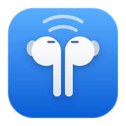

<h1 align="center">WPods</h1>

A free, open-source app that brings your AirPods' features to Windows 11.

> [!TIP]
> **No Test Mode. No Secure Boot changes.** Most AirPods apps for Windows ask you to switch Windows into Test Mode to get all their features, which lowers your PC's security. WPods doesn't: you install it like any other app, and Secure Boot stays on. To our knowledge, WPods is the only AirPods app for Windows that gives you every feature this way.

> [!NOTE]
> WPods is an independent project. It is not made, affiliated with, sponsored, endorsed or supported by Apple Inc. Apple product and feature names are used only to describe compatibility.

  <a href="https://github.com/FPNDev/wpods/releases/latest"><b>Download</b></a> |
  <a href="#features"><b>Features</b></a> |
  <a href="#before-you-install"><b>Before you install</b></a> |
  <a href="#install"><b>Install</b></a> |
  <a href="#uninstall"><b>Uninstall</b></a> |
  <a href="#help-and-feedback"><b>Help</b></a>

## Preview

<picture><source media="(prefers-color-scheme: dark)" srcset="docs/screenshots/home-top-dark.png">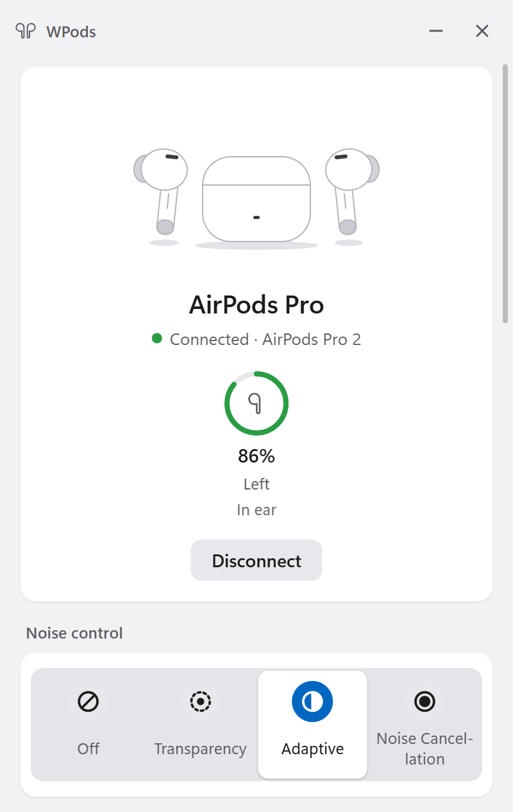</picture>

<picture><source media="(prefers-color-scheme: dark)" srcset="docs/screenshots/popup-desktop-dark.png">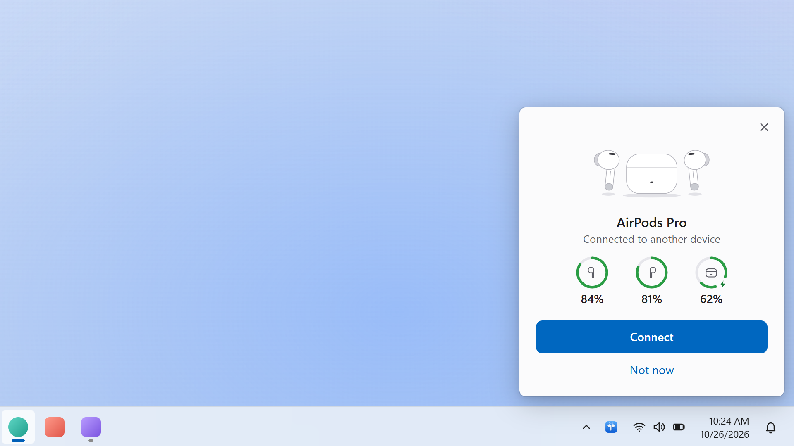</picture>

<i>The nearby popup on a Windows 11 desktop.</i>

See the full home screen

<picture><source media="(prefers-color-scheme: dark)" srcset="docs/screenshots/home-dark.png">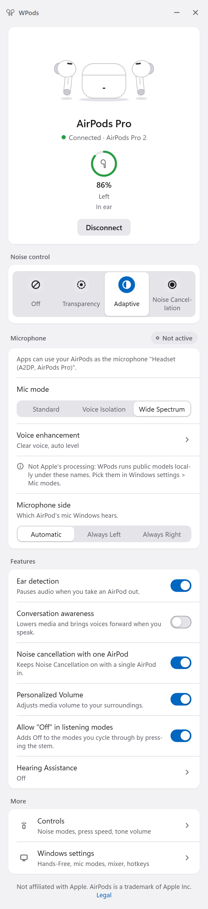</picture>

## Why WPods

- **Free and open source.** GPL-3.0, no drivers of its own. No trial, no subscription.
- **Stereo sound while the mic is on.** Your AirPods mic shows up in Windows as `Headset (A2DP, <AirPods name>)`, for example "Headset (A2DP, AirPods Pro)". Music and game audio stay stereo instead of dropping to the low-quality hands-free mode.
- **Mic modes you can tune.** Standard, Voice Isolation and Wide Spectrum, each with a choice of noise-suppression models that run locally on your PC. Over a dozen models, plus Raw (no processing). Every model shows how heavy it is.
- **Voice enhancement.** Make your voice clearer and more even for calls.
- **Full AirPods controls.** Noise control with Adaptive, conversation awareness with an adjustable "Lower media to" level, Personalized Volume, Hearing Aid and Media Assist, heart rate on AirPods Pro 3, press speed, press-and-hold settings, tone volume and more.
- **Nearby popup, like on iPhone.** When your AirPods are near and connected to another device, WPods shows them with their battery. One click to connect. Works with several pairs.
- **Hotkeys that work anywhere.** Switch noise control and mic modes, or turn the mixer, low latency, Hearing Aid and more on and off, without leaving your game or call. A small notification and a soft sound confirm each change.
- **Mixer.** Hear your own mic or any other audio device in your AirPods, each at its own volume, on top of everything else.
- **Low audio latency mode** for games and calls. It keeps your AirPods' sound and mic awake, so game sounds don't arrive late and your voice comes through the moment you start talking.
- **One installer does it all.** It installs .NET and WebView2 if missing, plus WPods' background service and usbip-win2. Works with Secure Boot on.
- **Looks at home on Windows.** Light, Dark or Auto theme and your Windows accent color. 45 languages.

## Features

Features show only when your AirPods model supports them. See [Supported AirPods](#supported-airpods).

### Connection and battery

- Connect, Disconnect and Reconnect from the Home screen. Connecting takes your AirPods over from another device, such as your phone.
- Left, Right and Case battery with rings and charging state. AirPods Max show one battery value. You get a message when the battery is low.
- Several pairs of AirPods? Switch between them from the Home header.
- "Pair new AirPods" guide in 3 steps: open the lid, hold the back button until the light flashes white, choose them in Windows "Add a device".

### Ear detection

- See each AirPod's state: In ear, Out or In case.
- "Ear detection" pauses audio when you take an AirPod out (AirPods Max: when you take them off).

### Noise control

- Off, Transparency, Adaptive (on models that support it) and Noise Cancellation.
- Noise Cancellation and Adaptive need both AirPods in, unless you turn on "Noise cancellation with one AirPod".
- "Allow 'Off' in listening modes" adds Off to the modes you switch between by pressing and holding the stem (AirPods Max: the noise control button).

### Controls

<picture><source media="(prefers-color-scheme: dark)" srcset="docs/screenshots/controls-dark.png">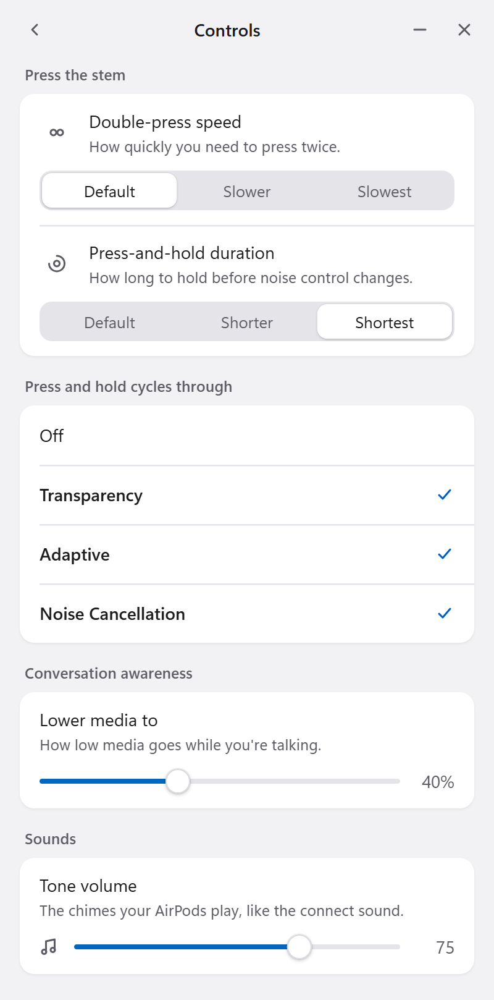</picture>

- Double-press speed: Default, Slower or Slowest.
- Press-and-hold duration: Default, Shorter or Shortest.
- "Press and hold cycles through": pick at least 2 of Off, Transparency, Adaptive and Noise Cancellation.
- Tone volume for chimes like the connect sound.
- Conversation awareness "Lower media to" level, from 10% to 90%.

### Hearing and health

- **Conversation awareness** lowers your media and brings voices forward when you speak.
- **Personalized Volume** adjusts media volume to your surroundings.
- **Hearing Assistance** (AirPods Pro 2 and Pro 3): Hearing Aid, plus Media Assist for music, video and calls. Both use the hearing settings from your iPhone or iPad, so set those up there first. Hearing Aid works in Transparency. Media Assist for calls only works when the call uses Hands-Free mode.
- **Heart rate** (AirPods Pro 3) shows your BPM from the AirPods sensors. Not a medical device.

### Microphone

<picture><source media="(prefers-color-scheme: dark)" srcset="docs/screenshots/mic-modes-dark.png">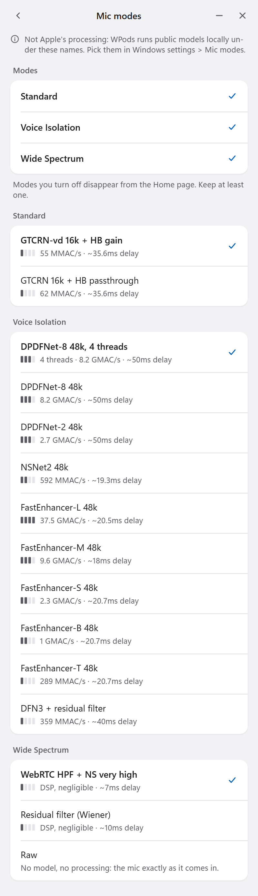</picture>

- Microphone side: Automatic, Always Left or Always Right.
- **Mic modes:** Standard, Voice Isolation and Wide Spectrum. Pick one on the Home screen. Turn modes on or off and choose the model for each mode in WPods' Windows settings page > Mic modes. Each model shows how heavy it is on your PC and how much delay it adds.
- **Voice enhancement:** Off, Apple-inspired, Clear voice auto level or Clear voice full-range level. Applies to every pair.

> [!NOTE]
> Mic modes are WPods' own processing, not Apple's. WPods runs open noise-suppression models on your PC and uses Apple's mode names for them.

All mic mode models

- **Standard:** GTCRN-vd 16k + HB gain (default), GTCRN 16k + HB passthrough.
- **Voice Isolation:** DPDFNet-8 48k (default), DPDFNet-8 48k 4 threads, DPDFNet-2 48k, NSNet2 48k, FastEnhancer-L/M/S/B/T 48k, DFN3 + residual filter.
- **Wide Spectrum:** WebRTC HPF + NS very high (default), Residual filter (Wiener), Raw (no processing).

### Windows settings

<picture><source media="(prefers-color-scheme: dark)" srcset="docs/screenshots/windows-settings-dark.png">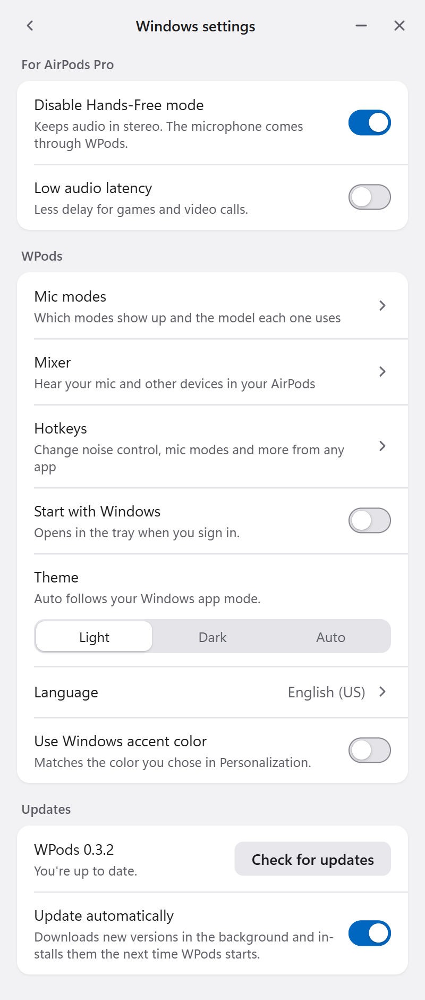</picture>

For each pair (while connected):

- **Disable Hands-Free mode** keeps audio stereo. The mic comes through WPods instead. If you leave Hands-Free mode on, an app that uses the Hands-Free mic takes over the AirPods mic, and `Headset (A2DP, <AirPods name>)` goes quiet until that app stops using it.
- **Low audio latency** gives less delay for games and calls. Your AirPods' sound and mic stay awake, so nothing has to wake up first: sounds play right away and your mic is live the moment an app opens it. It may use more battery.

For the app:

- Mic modes: turn modes on or off and pick a model for each.
- Mixer and Hotkeys (see below).
- Start with Windows (opens in the tray when you sign in).
- Theme: Light, Dark or Auto (Auto follows Windows).
- Language.
- Use Windows accent color.

### Mixer

<picture><source media="(prefers-color-scheme: dark)" srcset="docs/screenshots/mixer-dark.png">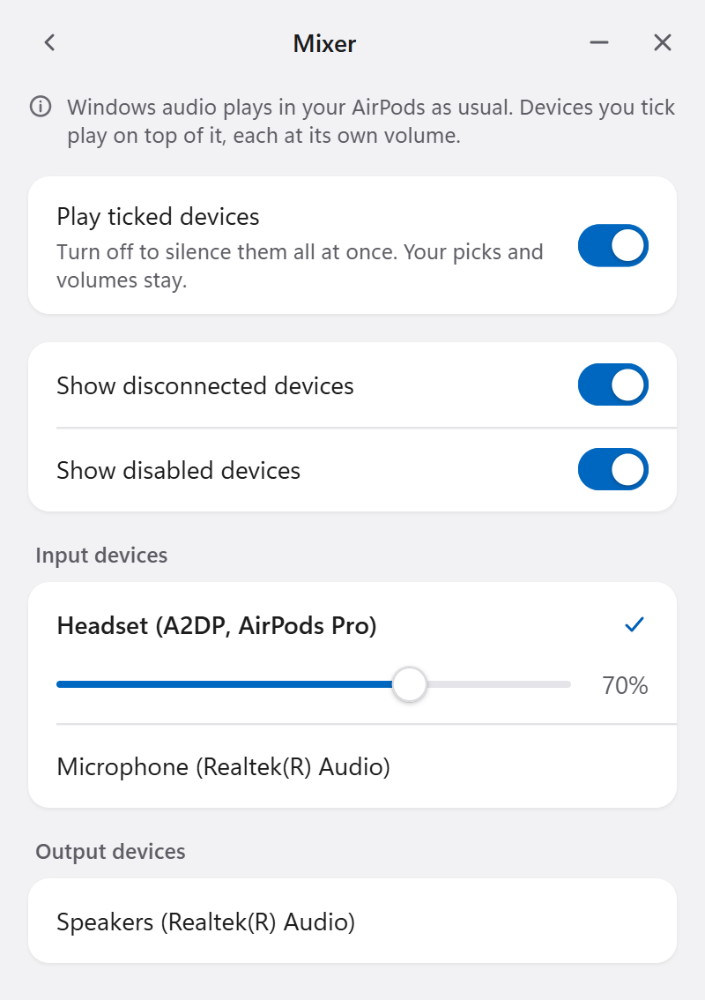</picture>

- Hear your AirPods mic, another microphone or any other output in your AirPods, on top of Windows audio. Handy for checking how you sound, or for listening to a second device.
- Tick a device to add it and set its own volume.
- "Play ticked devices" turns them all off at once and keeps your picks for next time.

### Hotkeys

<picture><source media="(prefers-color-scheme: dark)" srcset="docs/screenshots/hotkeys-dark.png">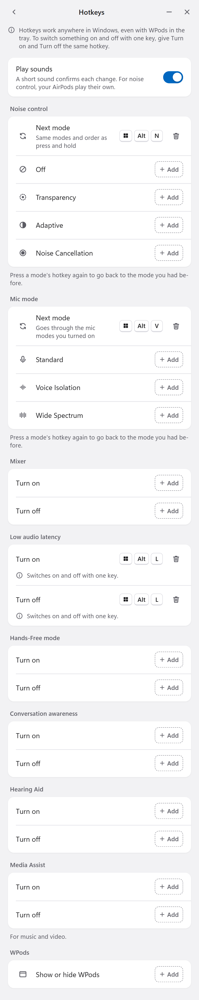</picture>

- Set your own keys in WPods' Windows settings page > Hotkeys. They work in any app, even when WPods is in the tray.
- **Noise control:** next mode (the same modes as press and hold) or a key per mode. Press a mode's key again to go back to the mode you had before.
- **Mic mode:** next mode (the modes you turned on) or a key per mode.
- **Turn on / Turn off:** Mixer, Low audio latency, Hands-Free mode, Conversation awareness, Hearing Aid and Media Assist. Give both the same key to switch with one press.
- **Show or hide WPods.**
- Ready to use: **Win+Alt+N** switches noise control, **Win+Alt+V** switches mic modes and **Win+Alt+L** turns low audio latency on and off. Change or remove them any time.
- Click a key to change it, press Esc to cancel, and Backspace or the trash button to remove it. WPods warns you when two actions clash on one key, or when another app already uses it.
- A small notification shows each change. Mic modes and on/off switches also play a short sound. If you don't like it - turn the sounds off on the Hotkeys page.

<picture><source media="(prefers-color-scheme: dark)" srcset="docs/screenshots/notification-dark.png">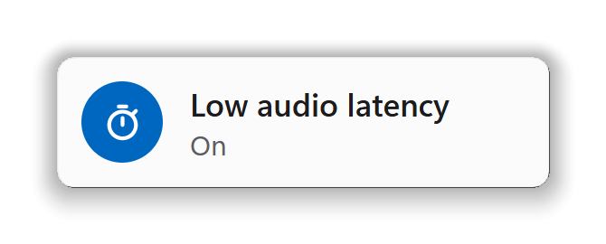</picture>

### Tray and nearby popup

- Closing the window keeps WPods in the tray. Tray menu: Open WPods, Start with Windows, Quit WPods.
- When your AirPods are near and connected to another device, a popup shows their picture, name and battery with Connect and Not now.
- Several pairs nearby? You get a "Connect AirPods?" list. Press Esc to dismiss.
- Nearby detection works after you connect your AirPods once.

### First run

<picture><source media="(prefers-color-scheme: dark)" srcset="docs/screenshots/first-run-dark.png">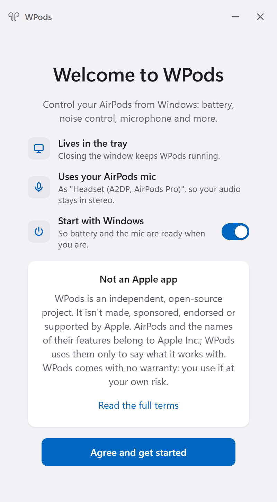</picture>

On first launch, WPods shows a short welcome with the terms and a note that it isn't made by Apple. You can find the legal page in the app at any time.

## Supported AirPods

Supports AirPods (1st, 2nd and 3rd gen), AirPods 4 and 4 (ANC), AirPods 5, AirPods Pro (1st gen), Pro 2 and Pro 3, and AirPods Max (1st gen) and Max 2. Battery works on all of them. Other features depend on the model:

- "Noise cancellation with one AirPod" works on AirPods 4 (ANC), AirPods 5 and all AirPods Pro.
- "Allow 'Off' in listening modes" works on AirPods Pro 2 and AirPods Pro 3.
- Hearing Aid and Media Assist work on AirPods Pro 2 and AirPods Pro 3.
- AirPods (1st gen) and AirPods (2nd gen) also support the microphone side setting.
- AirPods Max use head detection.

## How WPods compares

There are other projects for AirPods on Windows and beyond. Here is how they line up.

| Feature                                    | WPods        | [NTPods](https://github.com/arctumn/ntpods) (arctumn) | [NTPods](https://github.com/Ripthulhu/ntpods) (Ripthulhu fork) | [LibrePods](https://github.com/kavishdevar/librepods) | [MagicPods](https://magicpods.app/)  |
| ------------------------------------------ | ------------ | ----------------------------------------------------- | -------------------------------------------------------------- | ----------------------------------------------------- | ------------------------------------ |
| Platforms                                  | Windows 11   | Windows 10/11                                         | Windows 11                                                     | Android, Linux                                        | Windows (+ Linux via Steam)          |
| Price                                      | Free         | Free                                                  | Free                                                           | Free                                                  | Paid (trial)                         |
| Open source                                | Yes, GPL-3.0 | Yes, GPL-3.0                                          | Yes, GPL-3.0                                                   | Yes, GPL-3.0                                          | No                                   |
| Needs Test Mode                            | **No**       | Yes                                                   | Only for optional drivers                                      | No (Android: root on most devices)                    | Only for MagicAAP driver             |
| Battery incl. case                         | Yes          | Yes                                                   | Yes                                                            | Yes                                                   | Yes                                  |
| Ear detection                              | Yes          | Yes                                                   | Partial                                                        | Yes                                                   | Yes                                  |
| Noise control incl. Adaptive               | Yes          | Yes                                                   | Yes                                                            | Yes                                                   | Yes (with MagicAAP)                  |
| Conversation awareness                     | Yes          | Yes                                                   | Yes                                                            | Yes                                                   | Yes (with MagicAAP)                  |
| Personalized Volume                        | Yes          | Yes                                                   | Yes                                                            | Yes (Android)                                         | Yes (with MagicAAP)                  |
| Hearing Aid                                | Yes\*        | Experimental                                          | Experimental                                                   | Partial (Android, needs root)                         | No                                   |
| Heart rate                                 | Yes (Pro 3)  | Yes (Pro 3)                                           | Yes                                                            | Experimental (Android)                                | No                                   |
| Press-and-hold customization               | Yes          | No                                                    | Yes                                                            | Yes (Android)                                         | Yes (with MagicAAP)                  |
| Stereo audio while mic is on               | Yes          | Yes                                                   | Yes                                                            | Experimental                                          | No                                   |
| Mic noise-suppression modes (choose model) | Yes          | No                                                    | No                                                             | No                                                    | No                                   |
| Voice enhancement                          | Yes          | No                                                    | No                                                             | No                                                    | No                                   |
| Low-latency mode                           | Yes          | No                                                    | Yes                                                            | No                                                    | Yes                                  |
| Nearby popup                               | Yes          | Yes                                                   | Yes                                                            | Yes (Android)                                         | Yes                                  |
| Head gestures                              | No           | No                                                    | No                                                             | Yes (Android)                                         | No                                   |
| Non-Apple earbuds                          | No           | Partial (Beats)                                       | Partial (Powerbeats Pro 2)                                     | No                                                    | Yes (Beats, Galaxy Buds, Sony, more) |

\* Tested on AirPods Pro 2 only so far. Needs hearing set up on an iPhone or iPad first. WPods turns Hearing Aid and Media Assist on and off; it doesn't change the hearing settings themselves. Tried it on other AirPods? Please [open an issue](https://github.com/FPNDev/wpods/issues).

Based on each project's README, website and source code as of 2026-10-26. If something is wrong, please [open an issue](https://github.com/FPNDev/wpods/issues).

## Before you install

### Requirements

- Windows 11, x64.
- Administrator rights to install.
- Internet during setup, if .NET 10 Desktop Runtime or Microsoft Edge WebView2 Runtime are missing. Setup downloads them and runs them only if they are signed by Microsoft.

### Tested on

- **AirPods:** AirPods Pro 2 and AirPods Pro 3.
- **Bluetooth adapter:** Intel Wi-Fi 6E AX211 Bluetooth (USB ID 8087:0033).

Other AirPods models and other Bluetooth adapters (Realtek, MediaTek, Qualcomm, Broadcom and others) are supported but haven't been tested yet. On some PCs the Bluetooth adapter is one part of a combined USB device. WPods supports these too, but they haven't been tested yet either.

**Your adapter helps everyone.** Every Bluetooth adapter is a little different, so please tell us how WPods works with yours, even if everything just works: [send an adapter report](https://github.com/FPNDev/wpods/issues/new?template=adapter_report.yml). It takes two minutes and shows the next person that their adapter is safe to use.

### What Setup changes

- **Your Bluetooth adapter:** WPods' background service takes it over with WinUSB (built into Windows) and hands it back to Windows as a virtual adapter. Your Bluetooth devices keep working.
- **usbip-win2:** Setup silently installs these Microsoft-signed USB/IP drivers by Vadym Hrynchyshyn (BSD 2-Clause). They provide the virtual Bluetooth adapter and the WPods mic.
- **Reversible:** the adapter goes back to Windows' own driver when you uninstall WPods, and on its own if the takeover fails 3 times in 10 minutes.
- You do this at your own risk. WPods comes with no warranty.

### Upgrading from an older version that used Test Mode

Older versions of WPods needed Windows Test Mode and Secure Boot off. This version needs neither. Setup offers to turn Test Mode off and suggests turning Secure Boot back on. Have your BitLocker recovery key ready: Windows may ask for it after these changes.

## Install

1. **Download** `WPods-Setup.exe` from the [latest release](https://github.com/FPNDev/wpods/releases/latest).
2. **Run it.** Read and accept the terms. They explain the Bluetooth adapter takeover.
3. **Choose your options:**
   - Create a desktop shortcut (off by default).
   - Start WPods when I sign in (on by default).
   - Keep WPods up to date automatically (on by default).
4. Setup installs .NET and WebView2 if missing, then WPods, its background service and usbip-win2. Restart if Setup asks you to.
5. **Open WPods** and accept the terms on the welcome screen. Open your AirPods case near your PC (AirPods Max: take them out of the Smart Case) and click **Connect**. Not paired yet? Use "Pair new AirPods" or "Open Bluetooth settings".

If the install fails, run Setup again.

**Updating:** WPods keeps itself up to date. It checks for new versions, downloads them in the background and installs them the next time WPods starts. To update right away, click **Update now** when WPods shows a new version. You can turn automatic updates off in WPods' Windows settings page. Running a newer Setup by hand works too and keeps your choices.

## Uninstall

1. Open Windows **Settings > Apps > Installed apps**, find **WPods** and choose **Uninstall**.
2. Choose whether to also remove your WPods settings (No by default). It then gives your Bluetooth adapter back to Windows' own driver and removes WPods and the startup entry.

## Languages

WPods speaks 45 languages:

Arabic, Bangla, Bulgarian, Catalan, Chinese (Simplified; Traditional, Taiwan; Traditional, Hong Kong), Croatian, Czech, Danish, Dutch, English (US, UK, Australia, India), Finnish, French (France, Canada), German, Greek, Gujarati, Hebrew, Hindi, Hungarian, Indonesian, Italian, Japanese, Kannada, Kazakh, Korean, Lithuanian, Malay, Malayalam, Marathi, Norwegian Bokmal, Odia, Polish, Portuguese (Brazil, Portugal), Punjabi, Romanian, Slovak, Slovenian, Spanish (Spain, Latin America, US), Swedish, Tamil, Telugu, Thai, Turkish, Ukrainian, Urdu and Vietnamese.

Arabic, Hebrew and Urdu use a right-to-left layout. Translations other than English and Ukrainian were made with AI help and have not been reviewed by native speakers yet. Spotted something off? Please [open an issue](https://github.com/FPNDev/wpods/issues).

Choose "Same as Windows" or pick a language in WPods' Windows settings page. It switches right away.

## Help and feedback

Found a bug, have an idea, or something doesn't work with your AirPods? Please [open an issue](https://github.com/FPNDev/wpods/issues/new/choose).

### Reporting a problem

The issue form asks for a few details. They help us find the cause much faster, especially your Bluetooth adapter and the WPods logs.

How do I find my Bluetooth adapter?

1. Right-click the Start button and choose **Device Manager**.
2. Expand **Bluetooth**. Your adapter is the entry with a name like "Intel(R) Wireless Bluetooth(R)", "Realtek Bluetooth Adapter" or "MediaTek Bluetooth Adapter" (not your headphones or other devices).
3. Right-click it > **Properties** > **Details** tab > choose **Hardware Ids**. Copy the first line, for example `USB\VID_8087&PID_0033&REV_0000`.

Put the name and that line in your report.

How do I get the WPods logs?

WPods keeps two logs:

- The background service: `C:\ProgramData\WPods\logs`
- The app: `%LOCALAPPDATA%\WPods\logs` (paste this into the File Explorer address bar)

Right-click each `logs` folder > **Compress to ZIP file**, then drag both zips into the issue. If they are bigger than 25 MB, upload them to OneDrive, Google Drive or similar and paste the link.

The logs contain the names and Bluetooth addresses of your devices. They never contain pairing keys, audio, or anything you type.

Which Windows version do I have?

Press **Win+R**, type `winver` and press Enter. Copy the version and build, for example "Version 24H2 (OS Build 26100.2605)".

Which WPods version do I have?

Open WPods' Windows settings page. The version is shown under **Updates**.

## License and legal

WPods is free software under the GPL-3.0 license. See [LICENSE](LICENSE). Third-party components and their licenses are listed in [THIRD-PARTY-NOTICES.txt](THIRD-PARTY-NOTICES.txt).
WPods is not made, affiliated with, sponsored, endorsed or supported by Apple Inc.

Apple, AirPods, AirPods Pro, AirPods Max, iPhone, iPad and Mac are trademarks of Apple Inc., registered in the U.S. and other countries. Feature names (Noise Cancellation, Transparency, Adaptive, Conversation Awareness, Personalized Volume, Hearing Assistance, Hearing Aid, Media Assist, Standard, Voice Isolation, Wide Spectrum) are Apple's names, used only to describe compatibility.

WPods is provided as is, without warranty of any kind. Heart rate is not a medical device and is not for medical use.
