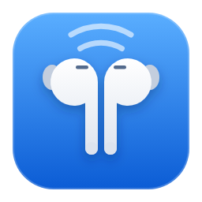
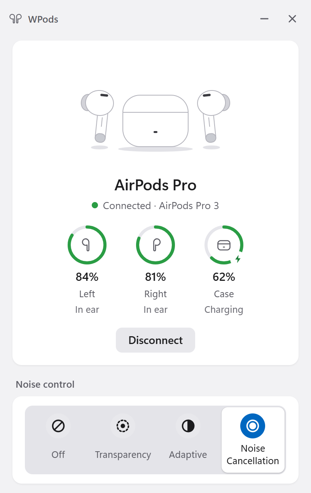
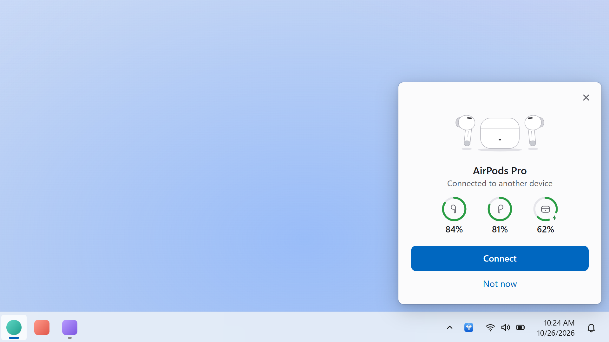
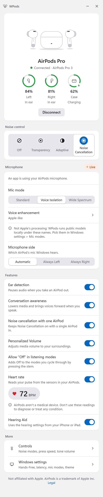
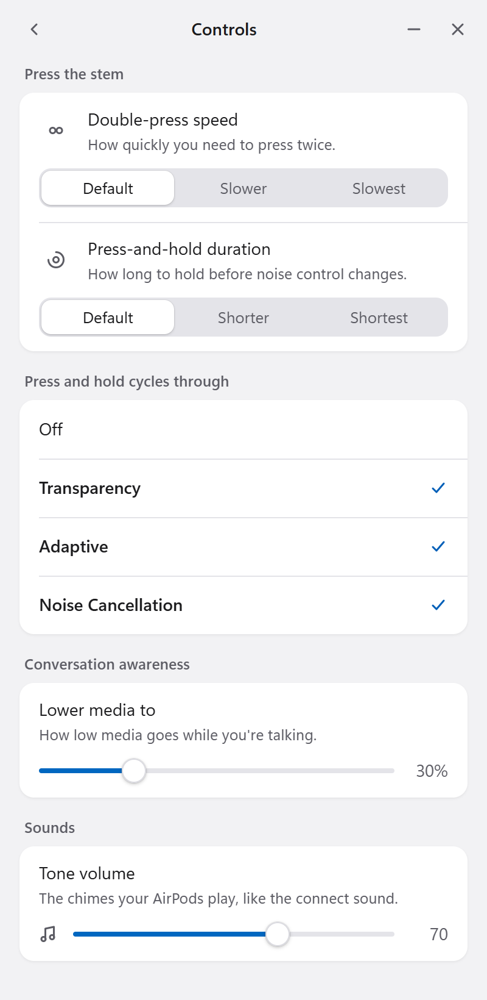
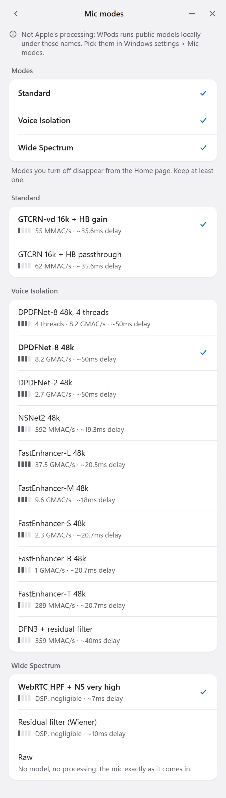
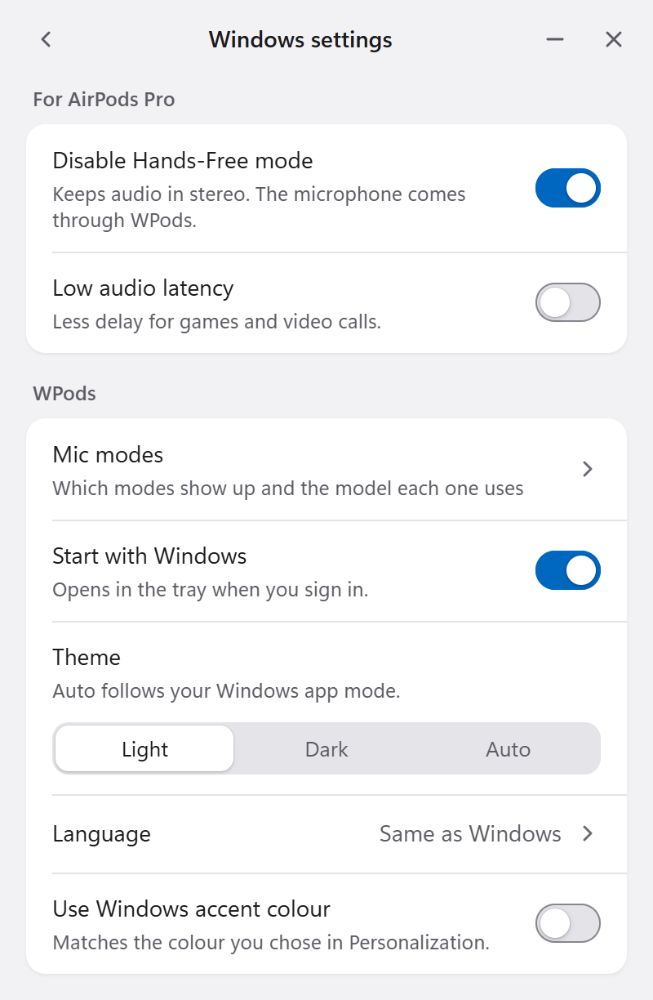
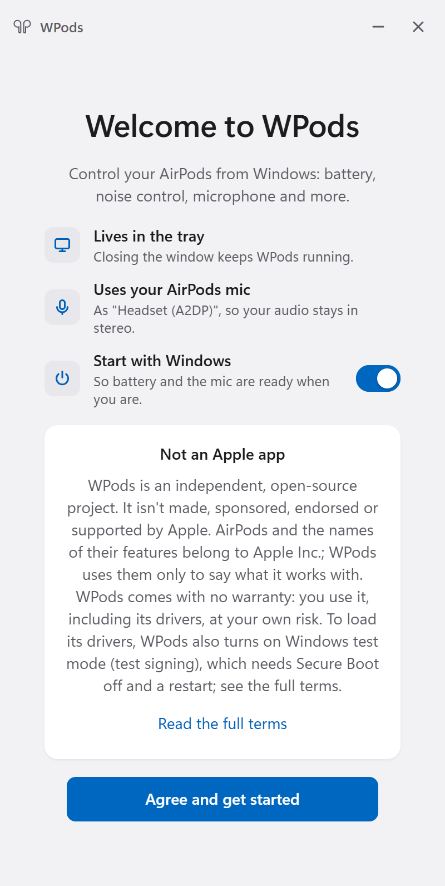

<p align="center"></p>

<h1 align="center">WPods</h1>

<p align="center">A free, open-source app that brings your AirPods' features to Windows 11.</p>

<div align="center">

[](LICENSE)
[](https://github.com/FPNDev/wpods/releases/latest)


</div>

> [!NOTE]
> WPods is an independent project. It is not made, affiliated with, sponsored, endorsed or supported by Apple Inc. Apple product and feature names are used only to describe compatibility.

> [!WARNING]
> WPods needs Windows **Test Mode** turned on and **Secure Boot** turned off. This lowers a Windows security protection while Test Mode stays on. Please read [Before you install](#before-you-install) first.

<p align="center">
  <a href="https://github.com/FPNDev/wpods/releases/latest"><b>Download</b></a> |
  <a href="#features"><b>Features</b></a> |
  <a href="#before-you-install"><b>Before you install</b></a> |
  <a href="#install"><b>Install</b></a> |
  <a href="#uninstall"><b>Uninstall</b></a> |
  <a href="#help-and-feedback"><b>Help</b></a>
</p>

## Preview

<p align="center"><picture><source media="(prefers-color-scheme: dark)" srcset="docs/screenshots/home-top-dark.png"></picture></p>

<p align="center"><picture><source media="(prefers-color-scheme: dark)" srcset="docs/screenshots/popup-desktop-dark.png"></picture></p>
<p align="center"><i>The nearby popup, drawn to scale in the bottom-right corner of a 1920x1080 desktop.</i></p>

<details>
<summary>See the full home screen</summary>
<p align="center"><picture><source media="(prefers-color-scheme: dark)" srcset="docs/screenshots/home-dark.png"></picture></p>
</details>

## Why WPods

- **Free and open source.** GPL-3.0, drivers included. No trial, no subscription.
- **Stereo sound while the mic is on.** Your AirPods mic shows up in Windows as "Headset (A2DP)". Music and game audio stay stereo instead of dropping to the low-quality hands-free mode.
- **Mic modes with real choice.** Standard, Voice Isolation and Wide Spectrum, each with a choice of noise-suppression models that run locally on your PC. 15+ models, including Raw (no processing). Every model shows how heavy it is. None of the other projects we compared offer this.
- **Voice enhancement.** Make your voice clearer and more even for calls. Also unique among the projects we compared.
- **Full AirPods controls.** Noise control with Adaptive, conversation awareness with an adjustable "Lower media to" level, Personalized Volume, Hearing Aid, heart rate on AirPods Pro 3, press speed, press-and-hold settings, tone volume and more.
- **Nearby popup, like on iPhone.** When your AirPods are near and connected to another device, WPods shows them with their battery. One click to connect. Works with several pairs.
- **Low audio latency mode** for games and calls.
- **One installer does it all.** It installs .NET and WebView2 if missing, sets up Test Mode and installs the drivers. Uninstall can turn Test Mode back off.
- **Looks at home on Windows.** Light, Dark or Auto theme and your Windows accent colour. 45 languages.

## Features

Features show only when your AirPods model supports them. See [Supported AirPods](#supported-airpods).

### Connection and battery

- Connect, Disconnect and Reconnect from the Home screen. Connecting takes your AirPods over from another device, such as your phone.
- Clear status: Connected (with the model name), Not connected, Connecting, Reconnecting, Couldn't connect, Connected to another device.
- Left, Right and Case battery with rings and charging state. AirPods Max show one battery value. You get a message when the battery is low.
- Several pairs of AirPods? Switch between them from the Home header.
- "Pair new AirPods" guide in 3 steps: open the lid, hold the back button until the light flashes white, choose them in Windows "Add a device".

### Ear detection

- See each AirPod's state: In ear, Out or In case.
- "Ear detection" pauses audio when you take an AirPod out (AirPods Max: when you take them off).

### Noise control

- Off, Transparency, Adaptive (on models that support it) and Noise Cancellation.
- Noise Cancellation and Adaptive need both AirPods in, unless you turn on "Noise cancellation with one AirPod".
- "Allow 'Off' in listening modes" adds Off to the stem cycle (AirPods Max: the noise control button).

### Controls

<p align="center"><picture><source media="(prefers-color-scheme: dark)" srcset="docs/screenshots/controls-dark.png"></picture></p>

- Double-press speed: Default, Slower or Slowest.
- Press-and-hold duration: Default, Shorter or Shortest.
- "Press and hold cycles through": pick at least 2 of Off, Transparency, Adaptive and Noise Cancellation.
- Tone volume for chimes like the connect sound.
- Conversation awareness "Lower media to" level, from 10% to 90%.

### Hearing and health

- **Conversation awareness** lowers your media and brings voices forward when you speak.
- **Personalized Volume** adjusts media volume to your surroundings.
- **Hearing Aid** uses the hearing settings from your iPhone or iPad. Set it up there first.
- **Heart rate** (AirPods Pro 3) shows your BPM from the AirPods sensors. Not a medical device.

### Microphone

<p align="center"><picture><source media="(prefers-color-scheme: dark)" srcset="docs/screenshots/mic-modes-dark.png"></picture></p>

- Your AirPods mic shows up in Windows as "Headset (A2DP)", so audio stays stereo.
- Mic status: Not active, Starting, Live or Problem.
- Microphone side: Automatic, Always Left or Always Right.
- **Mic modes:** Standard, Voice Isolation and Wide Spectrum. Pick one on the Home screen. Turn modes on or off and choose the model for each mode in Windows settings > Mic modes. Each model shows a weight label (light, medium, heavy, very heavy or not measured).
- **Voice enhancement** (for the whole app): Off, Apple-like, Clear voice auto level or Clear voice full-range level.

> [!NOTE]
> Mic modes are WPods' own processing, not Apple's. WPods runs public noise-suppression models locally on your PC under Apple's mode names.

<details>
<summary>All mic mode models</summary>

- **Standard:** GTCRN-vd 16k + HB gain (default), GTCRN 16k + HB passthrough.
- **Voice Isolation:** DPDFNet-8 48k (default), DPDFNet-8 48k 4 threads, DPDFNet-2 48k, NSNet2 48k, FastEnhancer-L/M/S/B/T 48k, DFN3 + residual filter.
- **Wide Spectrum:** WebRTC HPF + NS very high (default), Residual filter (Wiener), Raw (no processing).

</details>

### Windows settings

<p align="center"><picture><source media="(prefers-color-scheme: dark)" srcset="docs/screenshots/windows-settings-dark.png"></picture></p>

For each pair (while connected):

- **Disable Hands-Free mode** keeps audio stereo. The mic comes through WPods instead.
- **Low audio latency** gives less delay for games and calls. It keeps your AirPods awake and may use more battery.

For the app:

- Mic modes.
- Start with Windows (opens in the tray when you sign in).
- Theme: Light, Dark or Auto (Auto follows Windows).
- Language.
- Use Windows accent colour.

### Tray and nearby popup

- Closing the window keeps WPods in the tray. Tray menu: Open WPods, Start with Windows, Quit WPods.
- When your AirPods are near and connected to another device, a popup shows their picture, name and battery with Connect and Not now. You see Connecting, then Connected, or Couldn't connect with Try again.
- Several pairs nearby? You get a "Connect AirPods?" list. Press Esc to dismiss.
- Nearby detection works after you connect your AirPods once.

### First run

<p align="center"><picture><source media="(prefers-color-scheme: dark)" srcset="docs/screenshots/first-run-dark.png"></picture></p>

- A welcome screen shows the Apple non-affiliation notice and the terms to agree to. The legal page is always available in the app.

## Supported AirPods

Every model shows battery. Features show only when your model supports them.

Supports AirPods (1st, 2nd and 3rd gen), AirPods 4 and 4 (ANC), AirPods 5, AirPods Pro (1st gen), Pro 2 and Pro 3, and AirPods Max (1st gen) and Max 2.

- "Noise cancellation with one AirPod" works on AirPods 4 (ANC), AirPods 5 and all AirPods Pro.
- "Allow 'Off' in listening modes" works on AirPods Pro 2 and AirPods Pro 3.
- AirPods (1st gen) and AirPods (2nd gen) also support the microphone side setting.
- AirPods Max use head detection and show a single battery value.

## How WPods compares

There are other good projects for AirPods on Windows and beyond. Here is how they line up.

| Feature                                    | WPods        | [NTPods](https://github.com/arctumn/ntpods) (arctumn) | [NTPods](https://github.com/Ripthulhu/ntpods) (Ripthulhu fork) | [LibrePods](https://github.com/kavishdevar/librepods) | [MagicPods](https://magicpods.app/)  |
| ------------------------------------------ | ------------ | ----------------------------------------------------- | -------------------------------------------------------------- | ----------------------------------------------------- | ------------------------------------ |
| Platforms                                  | Windows 11   | Windows 10/11                                         | Windows 11                                                     | Android, Linux                                        | Windows (+ Linux via Steam)          |
| Price                                      | Free         | Free                                                  | Free                                                           | Free                                                  | Paid (trial)                         |
| Open source                                | Yes, GPL-3.0 | Yes, GPL-3.0                                          | Yes, GPL-3.0                                                   | Yes, GPL-3.0                                          | No                                   |
| Needs Test Mode                            | Yes          | Yes                                                   | Only for optional drivers                                      | No (Android: root on most devices)                    | Only for MagicAAP driver             |
| Battery incl. case                         | Yes          | Yes                                                   | Yes                                                            | Yes                                                   | Yes                                  |
| Ear detection                              | Yes          | Yes                                                   | Partial                                                        | Yes                                                   | Yes                                  |
| Noise control incl. Adaptive               | Yes          | Yes                                                   | Yes                                                            | Yes                                                   | Yes (with MagicAAP)                  |
| Conversation awareness                     | Yes          | Yes                                                   | Yes                                                            | Yes                                                   | Yes (with MagicAAP)                  |
| Personalized Volume                        | Yes          | Yes                                                   | Yes                                                            | Yes (Android)                                         | Yes (with MagicAAP)                  |
| Hearing Aid                                | Partial      | Experimental                                          | Experimental                                                   | Partial (Android, needs root)                         | No                                   |
| Heart rate                                 | Yes (Pro 3)  | Yes (Pro 3)                                           | Yes                                                            | Experimental (Android)                                | No                                   |
| Press-and-hold customization               | Yes          | No                                                    | Yes                                                            | Yes (Android)                                         | Yes (with MagicAAP)                  |
| Stereo audio while mic is on               | Yes          | Yes                                                   | Yes                                                            | Experimental                                          | No                                   |
| Mic noise-suppression modes (choose model) | Yes          | No                                                    | No                                                             | No                                                    | No                                   |
| Voice enhancement                          | Yes          | No                                                    | No                                                             | No                                                    | No                                   |
| Low-latency mode                           | Yes          | No                                                    | Yes                                                            | No                                                    | Yes                                  |
| Nearby popup                               | Yes          | Yes                                                   | Yes                                                            | Yes (Android)                                         | Yes                                  |
| Head gestures                              | No           | No                                                    | No                                                             | Yes (Android)                                         | No                                   |
| Non-Apple earbuds                          | No           | Partial (Beats)                                       | Partial (Powerbeats Pro 2)                                     | No                                                    | Yes (Beats, Galaxy Buds, Sony, more) |

Based on each project's README, website and source code as of 2026-10-26. If something is wrong, please [open an issue](https://github.com/FPNDev/wpods/issues).

## Before you install

### Requirements

- Windows 11, x64.
- Administrator rights to install.
- Bluetooth.
- Secure Boot turned off.
- A restart.
- Internet during setup, if .NET 10 Desktop Runtime or Microsoft Edge WebView2 Runtime are missing. Setup downloads them and runs them only if they are signed by Microsoft.

### Test Mode

> [!CAUTION]
> **WPods needs Windows Test Mode. Please read this before you install.**
>
> - WPods installs its own kernel drivers. They are test-signed by the WPods project, not signed by Microsoft.
> - To load them, Setup turns on Windows test signing (Test Mode). A restart is needed.
> - Test Mode requires Secure Boot to be off. If it is on, Setup stops and explains how to turn it off: restart into UEFI/BIOS, set Secure Boot to Disabled, save, then run Setup again. Have your BitLocker recovery key ready before changing Secure Boot.
> - **Security:** while Test Mode is on, Windows loads any test-signed kernel driver, not only WPods' drivers. This lowers a Windows security protection for as long as Test Mode stays on.
> - **BitLocker:** Setup suspends BitLocker for one restart, so turning on test signing does not trigger a recovery prompt.
> - Windows shows a "Test Mode" watermark on the desktop while Test Mode is on. See [The Test Mode watermark](#the-test-mode-watermark).
> - You do this at your own risk. WPods comes with no warranty.

> [!IMPORTANT]
> This is reversible. Uninstalling WPods can turn Test Mode off for you, or you can turn it off yourself. See [Uninstall](#uninstall). Once Test Mode is off, you can turn Secure Boot back on.

### The Test Mode watermark

With Test Mode on, Windows shows a "Test Mode" watermark in the corner of your desktop. WPods leaves it alone. If it bothers you, you can hide it with [no-test-mode-wm](https://github.com/FPNDev/no-test-mode-wm). It is a separate, unofficial tool that hooks into Windows Explorer, so it may stop working after Windows updates. Read its README before you use it.

## Install

1. **Turn off Secure Boot first.** Setup checks and tells you how. Have your BitLocker recovery key ready.
2. **Download** `WPods-Setup.exe` from the [latest release](https://github.com/FPNDev/wpods/releases/latest).
3. **Run it.** Read and accept the terms. They explain Test Mode.
4. **Choose your options:**
   - Create a desktop shortcut (off by default).
   - Start WPods when I sign in (on by default).
5. Setup installs .NET and WebView2 if missing, turns on Test Mode, and installs WPods and its drivers.
6. **Restart Windows.** The drivers load, and WPods can connect, only after the restart.
7. **Open WPods** and agree to the welcome screen. Open your AirPods case near your PC (AirPods Max: take them out of the Smart Case) and click **Connect**. Not paired yet? Use "Pair new AirPods" or Open Bluetooth settings.

If the driver install fails, run Setup again.

**Updating:** run the new Setup. It closes WPods and keeps your startup choice. Restart when convenient.

## Uninstall

1. Open Windows **Settings > Apps > Installed apps**, find **WPods** and choose **Uninstall**.
2. It asks "Also remove your WPods settings?" (default No).
3. It removes the drivers and the startup entry.
4. If WPods Setup turned Test Mode on, it asks "Turn Windows test mode off as well?" (default No). Say **Yes** to restore the default Windows protection.

To turn Test Mode off yourself, open a Command Prompt as administrator, run this, then restart:

```
bcdedit /set testsigning off
```

Once Test Mode is off, you can turn Secure Boot back on.

## Languages

WPods speaks 45 languages:

Arabic, Bangla, Bulgarian, Catalan, Chinese (Simplified; Traditional, Taiwan; Traditional, Hong Kong), Croatian, Czech, Danish, Dutch, English (US, UK, Australia, India), Finnish, French (France, Canada), German, Greek, Gujarati, Hebrew, Hindi, Hungarian, Indonesian, Italian, Japanese, Kannada, Kazakh, Korean, Lithuanian, Malay, Malayalam, Marathi, Norwegian Bokmal, Odia, Polish, Portuguese (Brazil, Portugal), Punjabi, Romanian, Slovak, Slovenian, Spanish (Spain, Latin America, US), Swedish, Tamil, Telugu, Thai, Turkish, Ukrainian, Urdu and Vietnamese.

Arabic, Hebrew and Urdu use a right-to-left layout. Translations other than English and Ukrainian were made with AI help and have not been reviewed by native speakers yet. Spotted something off? Please [open an issue](https://github.com/FPNDev/wpods/issues).

Choose "Same as Windows" or pick a language in Windows settings. It switches right away.

## Help and feedback

Found a bug, have an idea, or something doesn't work with your AirPods? Please [open an issue](https://github.com/FPNDev/wpods/issues).

## License and legal

WPods is free software under the GPL-3.0 license. See [LICENSE](LICENSE). Third-party components and their licenses are listed in [THIRD-PARTY-NOTICES.txt](THIRD-PARTY-NOTICES.txt).

WPods is not made, affiliated with, sponsored, endorsed or supported by Apple Inc.

Apple, AirPods, AirPods Pro, AirPods Max, iPhone, iPad and Mac are trademarks of Apple Inc., registered in the U.S. and other countries. Feature names (Noise Cancellation, Transparency, Adaptive, Conversation Awareness, Personalized Volume, Hearing Aid, Standard, Voice Isolation, Wide Spectrum) are Apple's names, used only to describe compatibility.

WPods is provided as is, without warranty of any kind. Heart rate is not a medical device and is not for medical use.
